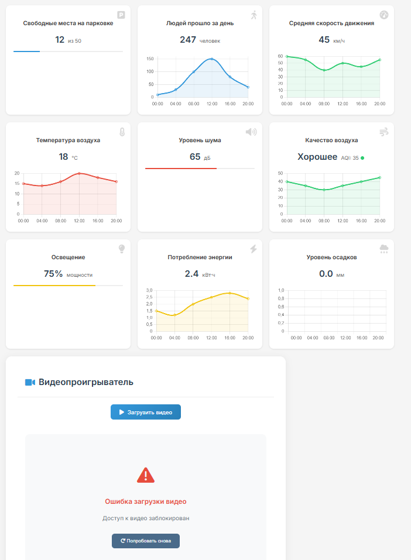
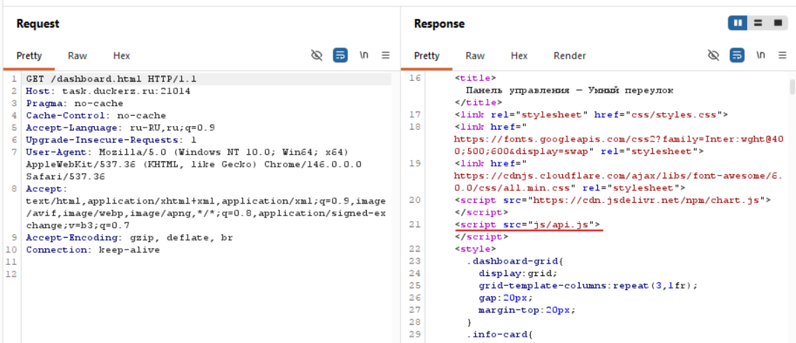
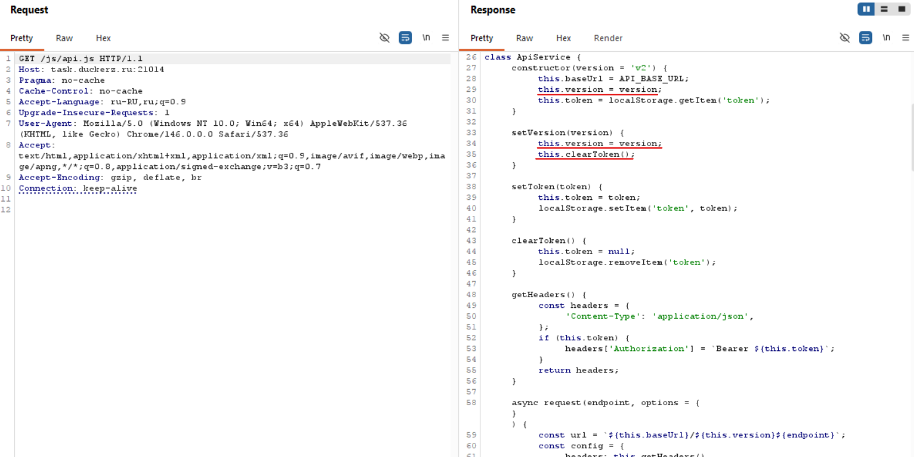

# Умный переулок — Broken Access Control через версионирование API

> **Категория:** Web
> **Сложность:** не указана в задании
> **Уязвимость:** Broken Access Control (отсутствие проверки авторизации на старой версии API)
> **Цель:** task.duckerz.ru:21014

---

## Входные данные

У меня есть дашборд «Умный переулок», показывающий статистику по камере на улице: трафик, шум, качество воздуха и т.д. На странице также есть видеопроигрыватель, но при попытке загрузить видео выдаётся ошибка «Доступ к видео заблокирован».

Других кнопок или функций на сайте нет.



---

## Разведка

### 1. Проверка формы регистрации на XSS

Попробовал в поле username указать чувствительные символы `qwerty<>'"`. Сайт не экранирует ввод и выводит значение на дашборд как есть, но исполнения скрипта не произошло — похоже, вывод всё-таки достаточно безопасен (например, через `textContent`, а не `innerHTML`), либо есть другая защита. XSS не сработал, иду дальше.

### 2. Разведка эндпоинтов

Посмотрел все ручки сайта — клиент общается с сервером через API. Попытка обратиться напрямую к `/api/v2/video` не удалась: сервер проверяет JWT-токен, подписанный `HS256`.

Попробовал несколько способов обхода JWT-проверки (в том числе брутфорс секрета через `hashcat`) — результата не дал. Переключился на другое направление атаки, не стал упираться в сам токен.

### 3. Находка `js/api.js`

На странице `dashboard.html` заметил подключаемый скрипт `js/api.js`.



Открыл этот файл напрямую — в нём оказалась логика работы с API:

```js
class ApiService {
    constructor(version = 'v2') {
        this.baseUrl = API_BASE_URL;
        this.version = version;
        this.token = localStorage.getItem('token');
    }

    setVersion(version) {
        this.version = version;
        this.clearToken();
    }

    setToken(token) {
        this.token = token;
        localStorage.setItem('token', token);
    }

    clearToken() {
        this.token = null;
        localStorage.removeItem('token');
    }
    ...
```



### 4. Ключевое наблюдение

По умолчанию клиент использует `v2` — именно эту версию и проверяет сервер через JWT. Но в коде есть метод `setVersion(version)`, который **меняет версию API и одновременно сбрасывает токен** (`clearToken()`).

Это навело на мысль: раз у API есть версионирование, значит существуют и другие версии — и не факт, что все они защищены одинаково. Раз смена версии сама обнуляет токен, а сайт при этом не просит его заново — вероятно, не все версии вообще требуют авторизации.

### 5. Перебор версий API

Перебрал версии от 0 до 10 через `setVersion()` в консоли / прямые запросы к `/api/vN/video`. Версия **1** оказалась рабочей — видео отдалось **без токена**.

---

## Эксплуатация

```js
apiService.setVersion('v1');
// дальше запрос к /api/v1/video уже уходит без авторизации
```

Получил доступ к видеозаписи с камеры переулка. Просмотрев её, заметил человека, держащего в руках листок с флагом.


---

## Риск уязвимости

- **Broken Access Control на уровне версионирования API.** Актуальная версия (`v2`) защищена проверкой JWT, но устаревшая версия (`v1`) осталась доступной публично и не проверяет авторизацию вообще.
- Это классический случай, когда **при добавлении новой версии API старую забыли либо вывести из эксплуатации, либо закрыть тем же уровнем защиты**, что и новую.
- Само наличие `setVersion()` в клиентском JS, который сбрасывает токен при смене версии, косвенно намекает, что разработчики знали о разном поведении версий, но не продумали последствия для безопасности.
- В данном случае это привело к утечке видеопотока с камеры наблюдения — потенциально чувствительных данных (слежка за реальным местом, людьми на видео).
- Поскольку обход не требует взлома JWT, брутфорса или какой-либо аутентификации — только перебор версии в URL — эксплуатация тривиальна.

Severity — **High**: защита полностью обходится без учётных данных, через простой перебор версии API, что даёт доступ к видеонаблюдению в обход авторизации.

---

## Меры по исправлению

1. **Выводить старые версии API из эксплуатации**, а не оставлять их доступными "на всякий случай" после перехода на новую версию.
2. **Применять единую политику авторизации ко всем версиям API**, а не только к актуальной — если `v2` требует токен, `v1` должен требовать его так же (либо быть вообще недоступен).
3. **Не хранить логику версионирования только на клиенте.** Решение о том, какая версия доступна и с какими правами — должно приниматься и проверяться на сервере, а не определяться тем, что просто отправил клиент в URL.
4. **Регулярно аудировать список реально доступных эндпоинтов**, включая версии, не упомянутые в текущей документации или фронтенде.
5. **Не оставлять в клиентском коде функции, меняющие критичное поведение (смену версии API) без соответствующей защиты на сервере** — раз такая функция есть в JS, нужно убедиться, что сервер не доверяет версии вслепую.

---

## Чему я научился

- Научился внимательнее смотреть все эндпоинты и статику сайта — долго не мог найти `js/api.js`, хотя он был прямо подключён на странице.
- Понял, что если у API явно указана версия (`v2`, `baseUrl`), значит почти наверняка существуют и другие версии — их стоит перебирать, а не считать, что есть только актуальная.
- Попробовал брутфорсить секрет JWT (`HS256`) через `hashcat` — к финальному решению это не привело, но дало опыт работы с инструментом в контексте атак на JWT.
- Понял, что уязвимости бывают не только в самой логике эндпоинта, но и в том, как **разные версии одного и того же API** защищены по-разному — это отдельный класс проблем (broken access control через API versioning), а не просто баг в одном месте.
